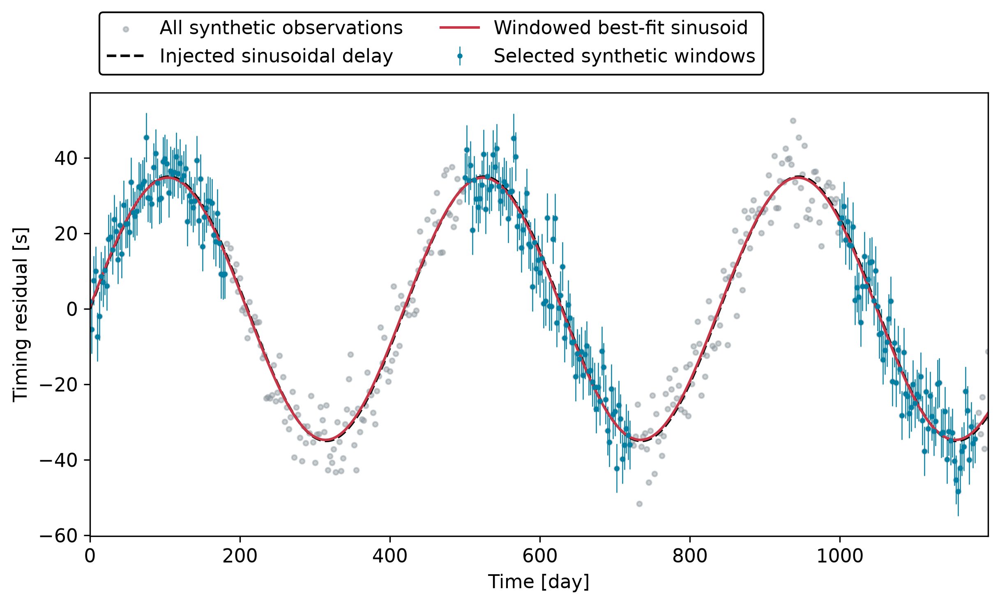

# chronos

Can eclipse-timing variations reveal a circumbinary planet when TESS observes the binary in separated windows? We simulate eclipsing binaries and planets, sample eclipse times within the TESS observing windows, add timing noise, and search the resulting variations with a Lomb-Scargle periodogram. Estimated recovery depends on the assumed populations and timing-noise model.

Set `CHRONOS_PATH` to the checkout directory when running the sampler from elsewhere. If unset, Chronos uses its checkout root. `etv_sampler.py` reads `TESS_orbit_times.csv` from the ignored `data/` directory and writes `etv_sample.csv` there. Generated figures can go in the ignored `visuals/` directory.

## Timing-search example

In [Observing windows and eclipse timing](examples/WindowedTiming.ipynb), we compare continuous synthetic sampling with three artificial observing windows. The notebook calls Chronos's timing-noise, window-selection, and Lomb-Scargle functions through [the example script](examples/windowed_timing.py). It displays the assumed signal, noisy timing measurements, fitted sinusoid, and period-search curves.



The assumed signal has a 35-second amplitude and a 420-day period. Hypothetical eclipses occur every 2.5 days over 1200 days, with independent Gaussian noise. The observing windows and timing signal are synthetic. The figures show their effect on the measured timing residuals and period search.

From the checkout root:

```bash
python examples/windowed_timing.py --bokeh
python examples/windowed_timing.py --typeplotback dark --typefileplot pdf
```

The example writes PNG or PDF figures and optional self-contained Bokeh HTML directly under `examples/visuals/`. Those generated files remain ignored. The notebook embeds its static figures, and `images/` holds the README preview. NumPy, pandas, SciPy, Astropy, Matplotlib, and TDpy are needed for the calculation and static plots. The notebook additionally needs IPython and Bokeh.

## Full orbit recovery

Run `python etv_sampler.py` only after providing the observing-window table and the `rebound_model`, `lite_delay`, `tess_stars2px`, and `ticgen` modules. Those inputs are not bundled here. Importing `etv_sampler` does not start workers or create a catalog. Full orbit integration and population recovery remain separate from the timing-component example above.

## Tests

```bash
python -m pytest -q
```
